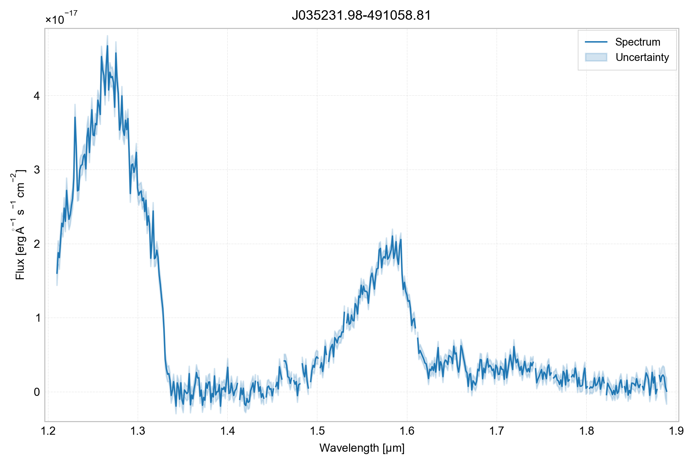
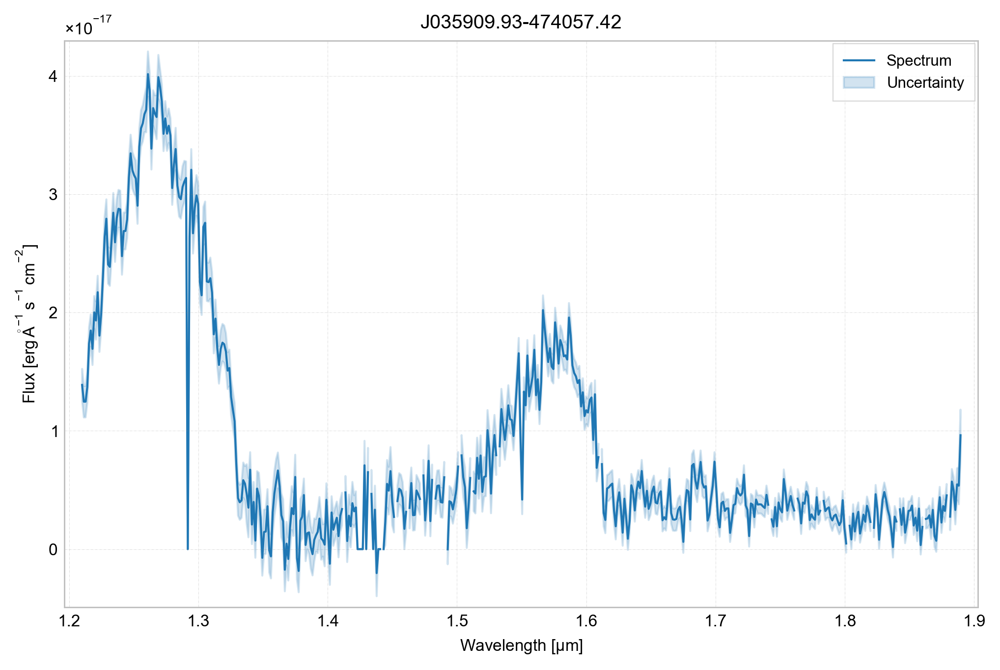
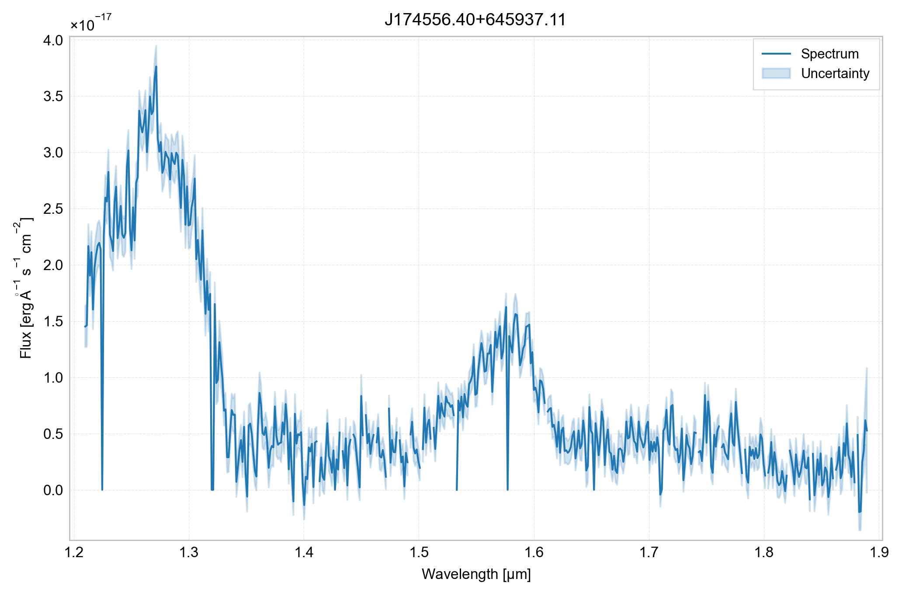
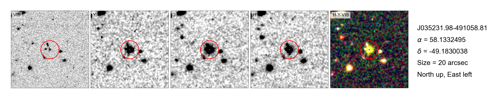
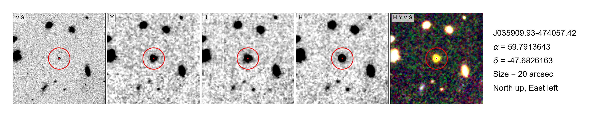
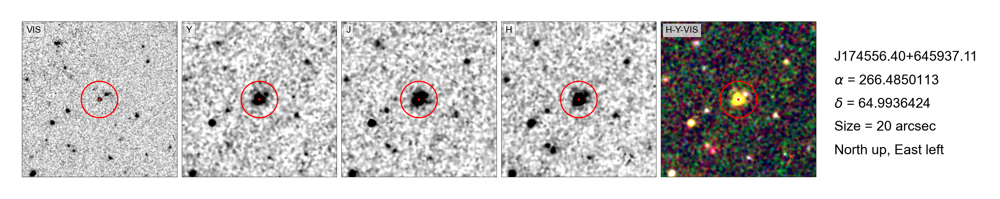
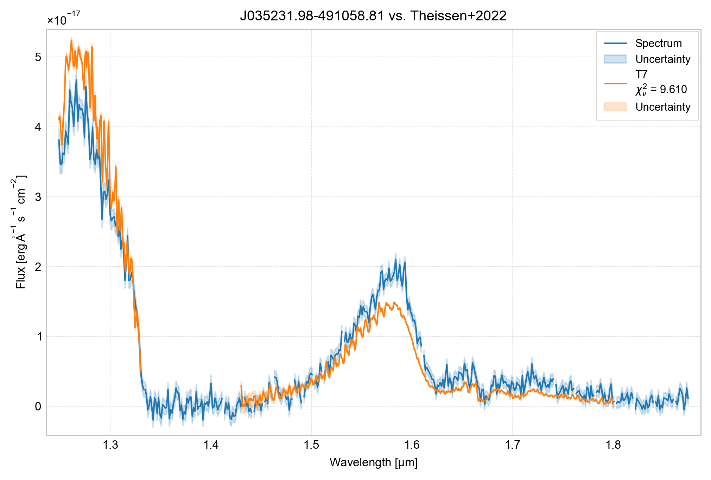
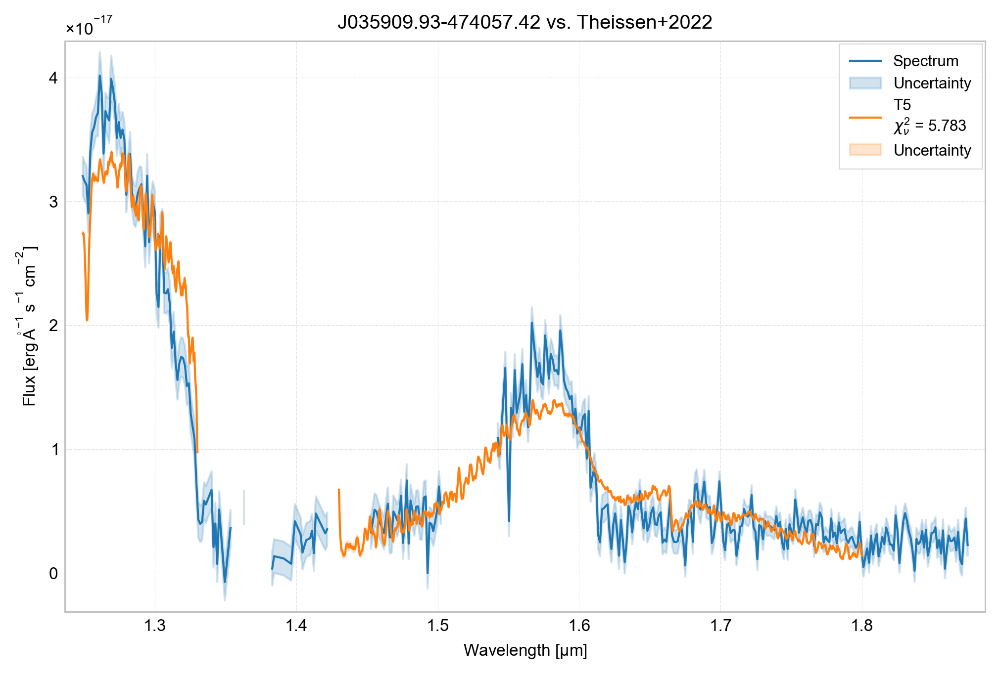
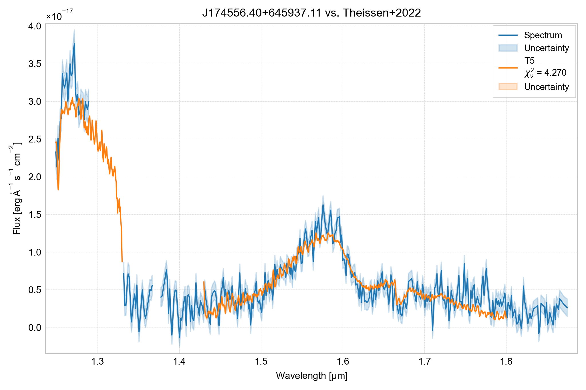

# Euclid Tools

[](https://www.astropy.org/)

A collection of tools to work with spectral and imaging data from the **ESA Euclid mission**, specifically tailored to
handle data from the **Euclid Quick Release 1 (Q1)**. This package supports the retrieval, visualization, and comparison
of Euclid spectra, as well as the retrieval and visualization of image cutouts.

The archive-facing API is intentionally backend-agnostic: both the ESA and IRSA implementations share the same public
contract, with `radius` and `search_radius` accepted as equivalent aliases for search size. This keeps code portable
across archive backends while preserving the underlying data access implementation details.

The toolkit is written in Python and is designed to be lightweight, modular, and extensible. It includes high-level
convenience functions for accessing and processing data, making it suitable for both exploratory data analysis and more
in-depth scientific research.

> **Note:** The tools are designed to support both **ESA** and **IRSA** data access. While functionality is similar
> between the two, **ESA services are significantly faster** and are preferred for most use cases.

The tools allow users to:

- Retrieve catalog objects, spectra, and image cutouts.
- Visualize spectra and images (RGB composites).
- Compare observed spectra to predefined templates.

## Functionality Overview

This toolkit provides the following core functionality:

- **Object Search and Data Retrieval**
    - Search for Euclid sources near specified sky coordinates.
    - Retrieve source data from the Euclid MER catalog.

> **Note:** The Euclid MER catalog does **not include magnitudes for Euclid bands**. To address this, the toolkit
> calculates magnitudes with uncertainties from the available flux columns using appropriate zero-points. Magnitudes are
> computed in both **AB** and **Vega** systems, and added directly to the result table returned by `retrieve_objects()`.
> VIS magnitude is derived from `flux_vis_psf` and Y, J, H magnitudes from `flux_[band]_templfit`.

- **Spectrum Retrieval and Visualization**
    - Retrieve NISP spectra (slitless grism) for individual sources.
    - Plot flux and uncertainty versus wavelength.

- **Image Cutout Retrieval**
    - Retrieve image cutouts in VIS, Y, J, and H bands for any Euclid-detected source.
    - Plot single- and multi-band image views (with customizable RGB assignments).

- **Spectral Comparison**
    - Mask unreliable flux or error values.
    - Match Euclid spectra to template libraries (e.g., Burgasser+2017, Theissen+2022).
    - Automatically evaluate fits using reduced χ² or other metrics.
    - Generate labeled and customizable comparison plots.

## Detailed Description

### Folder Structure:

The toolset consists of several scripts and modules:

- **`compare_spectrum_example.py`**: Example script to compare a spectrum with template SEDs.
- **`esa_tools_example.py`**: Example script for retrieving and plotting data from the ESA archive.
- **`irsa_tools_example.py`**: Example script for retrieving and plotting data from the IRSA archive.
- **`euclid_tools/esa_tools.py`**: Contains functions for interacting with the ESA archive.
- **`euclid_tools/irsa_tools.py`**: Contains functions for interacting with the IRSA archive.
- **`euclid_tools/image_plotter.py`**: Functions for plotting image cutouts.
- **`euclid_tools/backends.py`**: Backend factory and adapters (`get_backend`)
- **`euclid_tools/shared.py`**: Shared utility functions used across the toolset.
- **`flux_comp/core.py`**: Core functions for spectrum comparison and plotting (SED, WaveFlux)

### 1. `retrieve_objects()`

Access via `get_backend('esa')` or `get_backend('irsa')` — backends implement this method.

This function allows users to retrieve catalog objects from the Euclid archive based on coordinates and a specified
search radius.

#### Parameters:

- `ra`: Right Ascension of the target object.
- `dec`: Declination of the target object.
- `search_radius`: Radius (in arcseconds) around the target to search for objects.

#### Returns:

- An Astropy Table containing objects that are found within the specified search radius.

### 2. `retrieve_spectrum()`

Access via `get_backend('esa')` or `get_backend('irsa')` — backends implement this method.

This function retrieves the spectrum of a given object from the Euclid archive based on the object ID.

#### Parameters:

- `object_id`: The unique identifier of the object.
- `save_spectrum`: If True, saves the spectrum to a FITS file in the specified output directory.
- `output_dir`: Directory where the spectrum FITS file will be saved if `save_spectrum` is True.
- `object_name`: Name of the object to use for the output file name. If not provided, defaults to 'E{object_id}'.

#### Returns:

- An Astropy QTable containing the spectrum data, including wavelength, flux, and error.

### 3. `remove_bad_values()`

Access via `get_backend('esa')` or `get_backend('irsa')` — backends implement this method (helper function is provided in `euclid_tools.shared`).

This function mask bad values in the spectrum data based on the MASK column.

#### Parameters:

- `spectrum`: The input spectrum table containing columns WAVELENGTH, FLUX, ERROR, and MASK.
- `mask_func`: A function that takes the MASK column values and returns a boolean mask. Example:
  `lambda mask: (mask % 2 == 1) | (mask >= 64)`.

#### Returns:

- The modified spectrum data table with masked values replaced by NaN.

### 4. `retrieve_cutout()`

Access via `get_backend('esa')` or `get_backend('irsa')` — backends implement this method.

This function retrieves an image cutout for a given region around the target object and specified band (e.g., VIS, Y, J,
H).

#### Parameters:

- `ra`: Right Ascension of the target object.
- `dec`: Declination of the target object.
- `search_radius`: Radius (in arcseconds) to define the region of interest.
- `cutout_size`: Size (in arcseconds) of the cutout.
- `band`: The band (e.g., "VIS", "Y", "J", "H") to retrieve.

#### Returns:

- A FITS HDU containing the image cutout for the specified band.

### 5. Plotting spectra (`SED.plot()`)

Plotting of spectra is provided by the `flux_comp` package. The toolkit uses `flux_comp.core.SED` and
`flux_comp.core.WaveFlux` to build, convert, and render spectral plots. This approach centralizes comparison and
visualization logic in `flux_comp` rather than a separate local plotting helper.

#### Typical workflow:

- Build a WaveFlux object: WaveFlux(label, wavelength, flux, uncertainty)
- Create an SED and add the spectrum: sed = SED(name); sed.add(waveflux)
- Convert units if needed: sed.to_flux_lambda()
- Plot using sed.plot(...), with options such as spec_uncertainty and plot_format

#### Output:

- A saved plot (format controlled by `plot_format`) and optionally an open viewer when supported.

### 6. `plot_images()`

Located in `euclid_tools/image_plotter.py`.

This function generates plots for multiple images (cutouts) of the object in different bands (e.g., VIS, Y, J, H). The
images can be combined into RGB composites.

#### Parameters:

- `ra`: Right Ascension of the target object.
- `dec`: Declination of the target object.
- `images`: A list of dictionaries containing image data for each band.
- `img_size`: The size of the image cutout (in arcseconds).
- `image_contrast`: Contrast level to adjust the image brightness.
- `output_dir`: Directory where the plot will be saved.
- `open_plot`: Whether to open the plot file after saving.
- `plot_format`: The format of the plot (e.g., "pdf", "png").

#### Output:

- A saved plot of the RGB images.

### 7. Comparing spectra to templates (`SED.compare()`)

To compare an observed spectrum to a template, the `flux_comp` package is used. The script leverages the `SED` and
`WaveFlux` classes for the comparison, employing metrics such as reduced chi-squared.

#### Key steps:

1. Retrieve the catalog object based on RA, Dec.
2. Retrieve the spectrum for the object.
3. Retrieve template (s) for comparison (e.g., from "Theissen+2022").
4. Compare the spectrum to the templates using the reduced chi-squared metric.
5. Plot the comparison.

## Example Usages

### Example 1: Retrieving and Plotting a Spectrum

This example demonstrates how to retrieve a spectrum for an object and plot it using `flux_comp` (SED/WaveFlux).
The full example code can be found in `esa_tools_example.py`.

```python
from euclid_tools.backends import get_backend
from flux_comp.core import SED, WaveFlux

# Define object coordinates
# ra, dec = 58.1332495, -49.1830038
# ra, dec = 59.7913643, -47.6826163
ra, dec = 266.4850113, 64.9936424

# Search radius (arcsec)
search_radius = 5

# Use backend factory and perform search
backend = get_backend('esa')
results = backend.retrieve_objects(ra, dec, search_radius=search_radius)

if results:
    result = results[0]
    object_id = str(result["object_id"])

    # Retrieve spectrum data
    spectrum_data = backend.retrieve_spectrum(object_id)

    # Build a WaveFlux and SED and plot
    wf = WaveFlux(label="Spectrum", wavelength=spectrum_data["WAVELENGTH"], flux=spectrum_data["FLUX"], uncertainty=spectrum_data["ERROR"])
    sed = SED("Object")
    sed.add(wf)
    sed.to_flux_lambda()
    sed.plot(spec_uncertainty=True, plot_format="pdf")
else:
    print("No object found for the given coordinates and radius.")
```





### Example 2: Retrieving and Plotting Image Cutouts

This example shows how to retrieve image cutouts for a given object using different bands, and plot them using the
`plot_images` function. The full example code can be found in `esa_tools_example.py`.

```python
from euclid_tools.backends import get_backend
from euclid_tools.image_plotter import plot_images

# Define object coordinates and cutout size (arcsec)
# ra, dec = 58.1332495, -49.1830038
# ra, dec = 59.7913643, -47.6826163
ra, dec = 266.4850113, 64.9936424
cutout_size = 20  # arcsec

# Retrieve image cutouts for different bands via backend
backend = get_backend('esa')
search_radius = 5  # arcsec
vis_hdu = backend.retrieve_cutout(ra, dec, search_radius=search_radius, cutout_size=cutout_size, band="VIS")
y_hdu = backend.retrieve_cutout(ra, dec, search_radius=search_radius, cutout_size=cutout_size, band="Y")
j_hdu = backend.retrieve_cutout(ra, dec, search_radius=search_radius, cutout_size=cutout_size, band="J")
h_hdu = backend.retrieve_cutout(ra, dec, search_radius=search_radius, cutout_size=cutout_size, band="H")

# Prepare the images list for plotting
images = [
    {"hdu": vis_hdu, "band": "VIS", "rgb": "b"},
    {"hdu": y_hdu, "band": "Y", "rgb": "g"},
    {"hdu": j_hdu, "band": "J", "rgb": None},
    {"hdu": h_hdu, "band": "H", "rgb": "r"},
]

# Plot the images in a single figure
plot_images(ra, dec, images, cutout_size, plot_format="pdf")
```





### Example 3: Compare Spectrum to Template Using `flux_comp`

This example demonstrates how to use the Euclid tools to retrieve a spectrum for a given object
and compare it to predefined templates using the `flux_comp` tool. The full example code can be found in
`compare_spectrum_example.py`.

```python
from flux_comp.core import SED, WaveFlux, TemplateProvider
from euclid_tools.backends import get_backend
from euclid_tools.shared import remove_bad_values

# use backend factory
backend = get_backend('esa')

# Retrieve spectrum for an object
data = backend.retrieve_spectrum(object_id)

# Remove bad values from the spectrum to improve comparison results
data = remove_bad_values(data, mask_func=lambda mask: (mask % 2 == 1) | (mask >= 64))

# Retrieve templates for comparison
template_name = "Theissen+2022"
provider = TemplateProvider()
templates = provider.get_Theissen_2022_templates(smooth_window=10)

# Create a WaveFlux object
spectrum = WaveFlux(
    label="Spectrum", wavelength=data["WAVELENGTH"].filled(np.nan), flux=data["FLUX"], uncertainty=data["ERROR"]
)

# Compare the spectrum to the templates
sed = SED("Object vs. " + template_name)
sed.compare(spectrum, templates, trim_wave=True, metric="reduced-chi2")
sed.to_flux_lambda()
sed.plot(reference_on_top=False, spec_uncertainty=True)
```





## Installation

To install the Euclid Tools package, clone the repository and install the dependencies:

```bash
git clone https://github.com/fkiwy/Euclid_tools.git
cd Euclid_tools
pip install .
```

## Citation

If you use `Euclid_tools` in your work, please cite it using the following:

[](https://doi.org/10.5281/zenodo.17846221)
